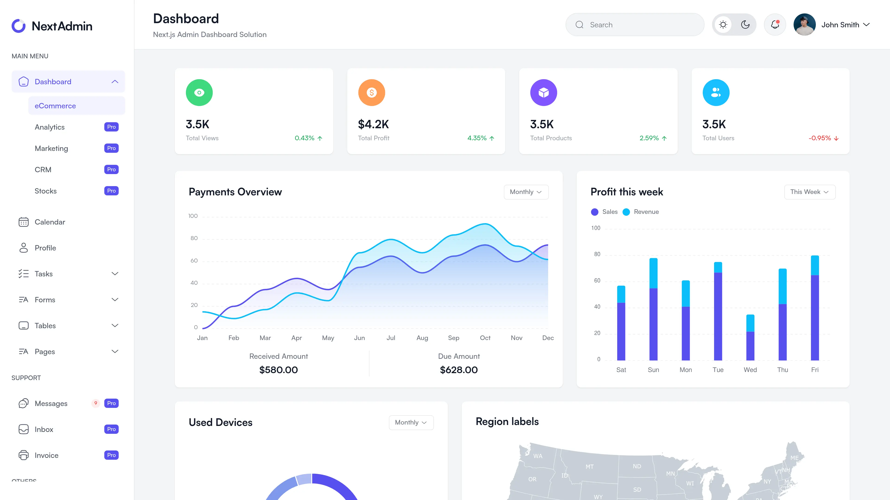

# Compass — National Land Acquisition Control Tower

> **Smart India Hackathon 2026** — Problem Statement SIH26016  
> "Real-Time National Land Acquisition & Management System for End-to-End Digital Monitoring and Decision Support"  
> Department of Land Resources, Ministry of Rural Development

**Tagline:** Navigate land acquisition, on time.

Compass is a prototype web platform that tracks every land acquisition project and parcel from proposal to handover, shows them on a GIS map, warns officials before a project slips, and lets landowners check their own status. It is a desktop-first monitoring and decision-support control tower for national land acquisition, built for the Smart India Hackathon 2026.

> **Prototype notice:** This is a demonstration prototype built with synthetic data. It is not an official government system, is not connected to any real land records portal, and is not deployed.

---

## 1. Overview

Compass gives officers and decision-makers a single view of land acquisition progress across projects and parcels:

- Track notified area, compensation due vs paid, possession percentage, and projects at risk.
- View parcels colour-coded by acquisition status on an interactive GIS map.
- Predict per-project delay risk with a client-side AI model and run "what-if" simulations.
- Compare corridor alignment options and review stage-by-stage workflow and audit history.

The app runs entirely in the browser for inference; data is served by Next.js API routes over a local in-memory store seeded from a deterministic dataset. There is no external backend and no database server.

---

## 2. Key features

| Feature | Description | Status |
|---|---|---|
| Overview dashboard | KPI cards (notified area, compensation paid, possession %, projects at risk), Recharts progress donut, parcels-by-status breakdown, top states by area, projects-at-risk table | Implemented |
| GIS parcel map | MapLibre GL JS map with parcels coloured by status, project cluster circles at low zoom, parcel polygons at zoom ≥ 8.5, corridor alignment layer, ULPIN-keyed parcel details drawer | Implemented |
| AI delay-risk prediction | Client-side Ordinary Least Squares risk model (score 0–100, risk level Low/Medium/High, top risk factors) trained offline and exported to JSON | Implemented |
| What-if simulator | Sliders for open objections, stage delay, compensation disbursed %, and forest clearance pending with live score and delay delta | Implemented |
| Project tracking | Searchable projects portfolio with state, sector, and risk-level filters; sortable risk table | Implemented |
| Compensation & SLA monitoring | Compensation progress bars, disputed-amount flags, statutory SLAs as generic stage deadlines, recommended actions per project | Implemented |
| Workflow + audit | Stage approvals by role (Ministry / State / District / Requiring Body / Field Officer), deadline countdowns, hash-chained audit log | Implemented |
| Filters & settings | State/project/status filters on parcels and projects, demo role switcher, "Reset Demo Data" control | Implemented |
| Notifications | Notification indicator panel (demo placeholder with empty state) | Placeholder |
| Landowner portal | ULPIN search on the parcels page; grievance form and multilingual support are roadmap items | Partial / roadmap |
| Responsive mobile interface | Accessible navigation drawer, mobile-friendly compact parcel map, touch-friendly controls (≥ 44 px hit targets) | Implemented |

The alignment checker (corridor option comparison, affected parcels/families/cost) is listed as the next chunk in the project roadmap and exists as an upgraded route in the current codebase.

---

## 3. Screenshots

Genuine project screenshots can be added here once available. Place image files under `public/` or `docs/reference/` and reference them with relative paths.

```markdown
## Screenshots

### Overview dashboard


### GIS parcel map


### Project risk detail

```

Do not add invented screenshot URLs or generated images.

---

## 4. Technology stack

| Layer | Technology | Role |
|---|---|---|
| Framework | Next.js 15 (App Router), React 19, TypeScript | Frontend + API routes |
| Styling | Tailwind CSS | Utility-first CSS |
| Mapping | MapLibre GL JS, CARTO Positron basemap, `@turf/turf` | Interactive GIS map, spatial analysis |
| Charts | Recharts | Progress donut and trend charts |
| Icons | lucide-react | UI icons |
| ML training | Python 3.11, scikit-learn | Standardized OLS delay-risk model (offline) |
| ML inference | TypeScript (`lib/risk.ts`) reading `public/model/risk-model.json` | Client-side prediction, zero server calls |
| Data | In-memory store seeded from `data/seed.json` | Projects, parcels, stages, payments, audit events |
| API | Next.js Route Handlers (`app/api/`) | `/api/parcels`, `/api/projects`, `/api/projects/[id]`, `/api/stats` |

**ML/AI:** A genuine machine-learning component is included. The model is trained offline with `/ml/train.py` (Python 3.11 + scikit-learn, 3,000 synthetic projects, 80/20 train/test split) and exported to `/public/model/risk-model.json`. In the app, `/lib/risk.ts` runs prediction entirely in the browser with zero server calls. The model is trained on synthetic data and is not for official statutory determination.

---

## 5. Architecture

Compass is a single-page Next.js application with no separate backend service. Page components call Next.js API Route Handlers, which read from an in-memory data store initialized from the deterministic seed file. The risk model runs client-side. MapLibre GL JS renders the GIS map with an offline-capable fallback basemap style.

```mermaid
graph TD
    Browser[User Browser]
    NextJS[Next.js 15 App Router<br/>React + TypeScript]
    API[API Route Handlers<br/>/api/parcels · /api/projects<br/>/api/projects/[id] · /api/stats]
    Store[In-Memory Data Store<br/>lib/data.ts ← data/seed.json]
    Risk[Client-Side Risk Inference<br/>lib/risk.ts ← public/model/risk-model.json]
    Map[MapLibre GL JS<br/>CARTO Positron basemap + offline fallback]
    Seed[scripts/seed.ts<br/>Mulberry32 PRNG, seed 42]
    Train[ml/train.py<br/>scikit-learn OLS model]
    ModelJSON[public/model/risk-model.json]

    Browser -->|HTTP| NextJS
    NextJS -->|server data| API
    API -->|reads| Store
    Browser -->|client inference| Risk
    Browser -->|renders GIS| Map
    Train -->|exports model| ModelJSON
    Risk -->|loads| ModelJSON
    Seed -->|generates| data/seed.json
```

- **Browser:** renders pages, map, charts, and runs risk-model inference locally.
- **Next.js App Router:** pages under `app/` plus API routes under `app/api/`.
- **API routes:** `GET /api/parcels`, `GET /api/projects`, `GET /api/projects/[id]`, `GET /api/stats` — all filterable by state/sector/status/risk level.
- **Data store:** `lib/data.ts` loads `data/seed.json` into memory at startup; `resetStore()` restores the original seed.
- **ML:** `ml/train.py` trains and exports the model; `lib/risk.ts` performs prediction and recommends actions.

---

## 6. Project structure

```
compass/
├── app/                  # Next.js App Router: pages and API routes
│   ├── api/              # Route handlers: parcels, projects, stats
│   ├── alignment/        # Corridor alignment checker route
│   ├── parcels/          # Land parcels GIS explorer route
│   ├── projects/         # Projects portfolio + [id] detail route
│   ├── payments/         # Payments route
│   ├── reports/          # Reports route
│   ├── settings/         # Settings route (role switcher, reset demo data)
│   ├── layout.tsx        # Root layout: header, sidebar, mobile-menu provider
│   ├── page.tsx          # Overview dashboard route (/)
│   ├── globals.css       # Global styles
│   └── mobile-menu-provider.tsx  # Mobile drawer state + backdrop
├── components/           # React components by feature
│   ├── dashboard/        # Overview dashboard widgets (KPI, donut, tables, compact map)
│   ├── map/              # Parcel map, parcel drawer, map wrapper
│   ├── parcels/          # Parcels explorer
│   ├── projects/         # Projects table, project detail, risk gauge, what-if simulator
│   ├── alignment/        # Alignment preview
│   ├── payments/, reports/, settings/
│   ├── Header.tsx        # Top navigation bar
│   └── Sidebar.tsx       # Navigation drawer (mobile-responsive)
├── lib/                  # Shared logic
│   ├── data.ts           # In-memory data store + access helpers
│   ├── risk.ts           # Client-side risk prediction + recommendations
│   ├── formatters.ts     # Unit formatting (INR crore/lakh, hectares, deltas)
│   ├── geo.ts            # Status colours and geo helpers
│   └── types.ts          # Shared TypeScript interfaces
├── ml/                   # Offline model training
│   └── train.py          # scikit-learn OLS training + JSON export
├── data/                 # Deterministic synthetic dataset
│   └── seed.json         # 15 projects, 303 parcels, 12 monthly snapshots
├── public/model/         # Exported model specification
│   └── risk-model.json
├── scripts/              # Seed and verification scripts
│   ├── seed.ts           # Deterministic data generation (seed 42)
│   └── verify*.ts        # Acceptance verification scripts
├── docs/                 # Reference screenshots and prompts
│   └── reference/
├── public/               # Static assets
├── next.config.mjs       # Next.js configuration
├── tailwind.config.ts    # Tailwind theme (status colours, shadows)
├── tsconfig.json         # TypeScript configuration
├── package.json          # Dependencies and npm scripts
├── LICENSE               # MIT License
├── AGENTS.md             # Project conventions and roadmap
├── PROGRESS.md           # Per-chunk implementation log
└── README.md             # This file
```

---

## 7. Getting started

### Prerequisites

- Node.js (v22 or later recommended)
- npm (bundled with Node)

Python 3.11+ and scikit-learn are only needed if you want to retrain the risk model (`ml/train.py`); they are not required to run the application.

### Installation

```bash
# Clone the repository
git clone https://github.com/abdullah-sidx/compass.git
cd compass

# Install dependencies
npm install
```

### Environment configuration

There is **no `.env.example` file** in this repository, and no environment variables, API keys, or secrets are required to run the app. MapLibre GL JS loads the free CARTO Positron vector basemap without an access token. Do not add real credentials to the repository.

### Development

```bash
# Start the development server
npm run dev
```

Open <http://localhost:3000>. The app reloads on file changes.

### Production build

```bash
# Type-check, lint, and build for production
npm run build

# Start the production server
npm run start
```

### Other scripts

| Command | Purpose |
|---|---|
| `npm run dev` | Start development server with hot reloading |
| `npm run build` | Production build (includes TypeScript type-check and ESLint) |
| `npm run start` | Start production server |
| `npm run lint` | Run ESLint |
| `npm run seed` | Regenerate the deterministic seed dataset (`data/seed.json`) |

---

## 8. Docker setup

**Docker is not configured in this repository.** There is no `Dockerfile` and no `docker-compose.yml`, so Docker Compose setup is not documented here. To containerize the app, add a `Dockerfile` based on a Node.js image that runs `npm install`, `npm run build`, and `npm run start`.

---

## 9. Mobile responsiveness

Compass is desktop-first (designed for 1280px+ viewports) with mobile adaptations:

- **Navigation drawer:** A hamburger button in the header (`md:hidden`) toggles a slide-in sidebar drawer. The drawer overlays the page with a dimmed backdrop; tapping the backdrop or the drawer's close button closes it. Navigation links close the drawer on tap and change the route.
- **Mobile parcel map:** On the `/parcels` page the map is reordered to appear immediately below the page title/description and above the filter controls, with a compact mobile height (~300–350 px) and full-width fit without horizontal overflow. Pan, zoom, and parcel selection remain functional on mobile.
- **Touch-friendly controls:** Interactive elements use minimum 44 × 44 px touch targets.
- **Overflow handling:** Body scroll is locked when the drawer is open; iOS momentum scrolling is enabled on scrollable containers via `-webkit-overflow-scrolling: touch`.

Test mobile layouts at device widths such as 360 × 800, 390 × 844, and 430 × 932 using your browser's device toolbar.

---

## 10. Testing and troubleshooting

### Available commands

- `npm run build` — production build; includes TypeScript type-checking and ESLint. This is the primary verification command.
- `npm run lint` — ESLint check.
- `npm run seed` — regenerate the deterministic seed file.

There is **no test framework** configured in this repository (no Jest/Vitest files or `test` script), so no automated test suite can be run.

### Common issues

| Issue | Likely cause | Fix |
|---|---|---|
| Port 3000 already in use | Another `next dev`/`next start` process is running | Stop the existing process on port 3000, then retry |
| Build fails with module-not-found | Stale `.next` cache from a concurrent dev server | Stop the dev server, delete `.next/`, and rerun `npm run build` |
| Map tiles fail to load | No internet connection (basemap tiles are remote) | The map falls back to an offline light style so parcel polygons and clusters still render |

---

## 11. Data and prototype limitations

Please read carefully before using this project:

- **All data is synthetic.** Projects, parcels, stages, payments, and audit events are generated by `scripts/seed.ts` using a Mulberry32 PRNG with fixed seed 42, producing 15 projects across 10 states and 7 sectors, 303 parcels, and 12 monthly snapshots. Data is stored in `data/seed.json` and loaded into an in-memory store.
- **Not real-time government data.** Do not describe the sample data as live or official land-acquisition data.
- **No real integrations.** There are no connections to Land Stack, Bhoomi Rashi, PFMS, PARIVESH, or any government portal. Where such systems are referenced, they are clearly labelled as mock adapters.
- **Statutory deadlines are generic SLAs,** not legal advice. Do not cite specific sections of land-acquisition law in the UI.
- **The risk model is a prototype.** Trained on synthetic data withheld-out R² of 0.9762 / MAE of 0.36 months (per `ml/train.py` training log). A production system would train on real pilot data. Not for official statutory determination.
- **ULPIN:** The 14-character alphanumeric parcel identifier is generated deterministically by the seed script; it is not a real government ULPIN.

---

## 12. Contributing, license, and acknowledgements

### Contributing

1. Fork the repository.
2. Create a feature branch: `git checkout -b feature/your-feature-name`.
3. Make your changes, keeping to one chunk at a time per the project conventions in `AGENTS.md`.
4. Verify with `npm run build` and `npm run lint`.
5. Commit with a clear message.
6. Push to your fork and open a pull request against `main`.

Follow the existing repository conventions: small readable files, shared types only in `lib/types.ts`, no hardcoded figures in components (numbers come from `lib/data.ts` or API routes), and synthetic data only.

### License

This project is licensed under the [MIT License](LICENSE).

Copyright (c) 2026 Abdullah Siddique.

### Acknowledgements

- Smart India Hackathon 2026 (SIH26016), Department of Land Resources, Ministry of Rural Development
- Next.js, React, Tailwind CSS, MapLibre GL JS, Recharts, lucide-react, `@turf/turf`
- CARTO Positron vector basemap
- Python 3.11 + scikit-learn (offline model training)

---

*Built as a Smart India Hackathon 2026 prototype. Not an official government system. Not deployed.*